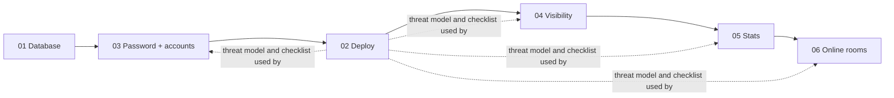

# Roadmap: hosted Trivia Builder

From a localhost party app to a site at `trivia.je-ng.ca` for friends and family. Source: the six bullets in `notes.md`, decided with Jess on 2026-11-24.

## The six plans

| Doc | Feature | Build order | PLAN.md phase |
| --- | --- | --- | --- |
| [01-database.md](01-database.md) | Supabase Postgres, JSON kept for offline | 1 | 16 |
| [03-site-password-and-accounts.md](03-site-password-and-accounts.md) | Site password, QR room tickets, accounts | 2 | 18 |
| [02-security-and-hosting.md](02-security-and-hosting.md) | Threat model, hosting choice, deploy | 3 | 17 |
| [04-question-visibility.md](04-question-visibility.md) | Private and public questions and playlists | 4 | 19 |
| [05-stats-dashboard.md](05-stats-dashboard.md) | Play stats, dashboard, popularity board | 5 | 20 |
| [06-online-rooms.md](06-online-rooms.md) | Many rooms, remote play | 6 | 21 |

Doc numbers follow `notes.md`. Build in the **Build order** column.

## Why this order

1. **Database first** because every other feature stores something per account. Its step 1 (making `library.js` async behind a storage interface) is the riskiest refactor in the set, and it lands while the app still behaves exactly as today, so a regression shows up on its own.
2. **Accounts before deploying.** Today's protection is "only the computer running the app can use the API" (`isLoopback` in `apps/builder/server/game.js`). On a hosted server that check means nothing, so the site must never be reachable before the gate exists. Read doc 02 before starting doc 03 anyway: its threat model is what the gate is built against.
3. **Deploy third**, as early as it's safe, so features 04 to 06 are tested on the real host, through Cloudflare, on phones over mobile data.
4. **Visibility before stats**, because the public popularity board only ranks public questions.
5. **Online rooms last.** It changes the relay that every phone feature depends on, and its remote mode builds on everything above: accounts for room ownership, public playlists for games, stats with `mode: 'remote'`.

## What each feature hands the next

- **01 → all:** `getStorage()` with JSON and Supabase adapters; every library call takes `ownerId`; `source: 'phone'` replaces `source: 'public'`.
- **03 → 02, 04, 06:** `req.account` on API requests, `accountId` and the room ticket on sockets, `profiles.is_admin`.
- **02 → all:** the pre-deploy checklist, the `rateLimit()` helper, `PUBLIC_ORIGIN`, the hosted error-message rule.
- **04 → 05, 06:** the availability rule (`owner_id = me or visibility = 'public'`, not deleted) and `publicView()`.
- **05 → 06:** `reportPlay()` and the `mode` column.

## Rules that apply to every doc

- **Offline mode keeps working.** `TRIVIA_STORAGE=json` (the default) runs with no gate, no accounts, one room and loopback hosting, as today. Every new check sits behind the hosted flag, and the existing tests keep passing in JSON mode.
- **Only the Node server talks to Supabase.** No Supabase URL or key in the client bundle. RLS on, no policies.
- **Owner scoping on every query.** The server's database connection bypasses RLS, so a missing `owner_id` filter is a data leak. Each storage method has a two-account test.
- **Never trust ids or names from the client** for who is acting: account from the session cookie, team and nickname from the join record (as the chat relay already does).
- **Parameterized queries only** (`postgres` tagged templates).
- **Update the root docs in the same PR** (`README.md`, `SCOPE.md`, `PLAN.md`, and `CLAUDE_PROMPTS.md` when a prompt is involved). Each doc lists which.

## How to apply a plan in a Claude Code session

1. Start the session with: "Read `docs/plans/00-roadmap.md` and `docs/plans/<doc>.md`, then build step N."
2. One step = one branch and one PR, branch named `feat/<doc-topic>-step-<n>` (for example `feat/database-step-1`), off an up-to-date `main`.
3. Before coding, check the doc's **Open questions**; ask Jess any that affect the step.
4. If the code has moved on and the doc is wrong (a renamed function, a file split), follow the code, fix the doc in the same PR, and say so in the PR description.
5. Finish with `npm test`, the step's **Verify** items, the docs listed in **Docs to update**, and tick the step in the status table below.

## Status

| Doc | Step 1 | Step 2 | Step 3 | Step 4 | Step 5 | Step 6 |
| --- | --- | --- | --- | --- | --- | --- |
| 01 Database | ☐ | ☐ | ☐ | ☐ | | |
| 03 Password + accounts | ☐ | ☐ | ☐ | ☐ | | |
| 02 Security + hosting | ☐ | ☐ | ☐ | ☐ | | |
| 04 Visibility | ☐ | ☐ | ☐ | ☐ | | |
| 05 Stats | ☐ | ☐ | ☐ | ☐ | | |
| 06 Online rooms | ☐ | ☐ | ☐ | ☐ | ☐ | ☐ |

## Decisions made with Jess

| Topic | Decision |
| --- | --- |
| Database | Supabase Postgres; JSON files kept for offline party mode |
| Existing data | One-time migration into Jess's account; harvester gets `--to-db` |
| Hosting | Compared in 02; recommended Fly.io behind Cloudflare on `trivia.je-ng.ca` |
| Accounts | Supabase Auth, email + password, self sign-up past the site password |
| Site password | Required for everyone; a room QR link carries a ticket for that room only |
| Phone-written questions | Saved private in the host's account |
| Public questions | Playable and addable to playlists by reference (read-only); can also be copied as an independent question |
| Public playlists | Yes; may hold only public questions |
| Unpublish or delete | Drops out of others' playlists as "no longer available"; copies unaffected |
| Stats visibility | Owner sees own; everyone sees a public-only popularity board |
| Online rooms | Many rooms at once, and a remote mode with full questions and media on each screen |
| Finding rooms | Code, link or QR only |

## Decisions made in the plans (review these)

- The browser never queries Supabase; the server sets its own `HttpOnly` session cookie (03).
- Email confirmation is off and resets are admin-only, because Supabase's built-in mailer only delivers to project team members (03).
- Stats are recorded when the host leaves the Answer Reveal, upserted per game and question (05).
- Popularity ranks by distinct host accounts, then games, over 30 days; miss rate needs 10 answers (05).
- The host browser stays in charge of game state; only the remote-mode timer moves to the server (06).
- Pictures in remote mode go through a media proxy so URLs like `Flag_of_France.svg` don't give answers away (06).
- Exactly one app machine, since rooms live in memory (02).

## Left out of the whole roadmap

- PLAN.md Phase 10 (hard mode, order questions, study mode) and Phase 13 step 4 (Stump the room). Independent of hosting; build them any time. Phase 13 steps 2 and 3 are superseded by 04.
- Native apps, push notifications, payments, and any open sign-up without the site password.
